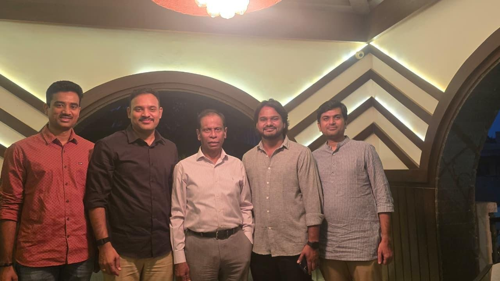

Today I met A.K. Khan sir, IPS (retd.), along with Karthik sir and Satish sir. He is a former Commissioner of Police, Hyderabad, and retired as Director General of the Anti-Corruption Bureau, Telangana.

We talked about how diplomacy works in the Mahabharata, and about why Indian society is beautiful: it chose the middle path. Somewhere in that conversation the line *ati sarvatra varjayet* came up, and I went looking for the full verse:

::: quote
*Ati dānād Balir baddho, ati mānāt Suyodhanaḥ,*\
*Vinaṣṭo Rāvaṇo lobhād, ati sarvatra varjayet.*

Bali was bound because he gave too much. Duryodhana (Suyodhana) fell because of too much pride. Ravana was destroyed by greed. So avoid excess in everything.

<cite>Sanskrit subhāṣita</cite>
:::

I have also registered for the [Kerala Literature Festival](https://keralaliteraturefestival.com/) in Kozhikode, thanks to Amal.
